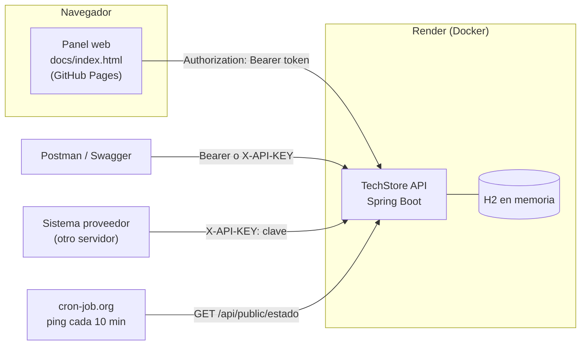

# TechStore API · API Keys vs. Bearer Tokens

Taller del curso **Desarrollo de Aplicaciones Móviles** (Ing. Renzo Bereche) — IESTP Gilda Ballivián, VI ciclo, Desarrollo de Sistemas de Información.

Backend en **Java + Spring Boot** que muestra los dos tipos de credenciales más usados en APIs, con el caso **TechStore** visto en clase:

| Quién llama | Credencial | Ejemplo en TechStore |
|---|---|---|
| **Una persona** (Ana, administradora) | **Bearer Token** (JWT) obtenido al iniciar sesión | El panel de administración crea y modifica productos |
| **Otro sistema** (el proveedor) | **API Key** fija, en el header `X-API-KEY` | El servidor del proveedor actualiza el stock automáticamente |

---

## Contenido

1. [Arquitectura](#arquitectura)
2. [Ejecutar en local (Windows + Git Bash)](#ejecutar-en-local-windows--git-bash)
3. [Usuarios de prueba](#usuarios-de-prueba)
4. [Endpoints](#endpoints)
5. [Probar con Postman](#probar-con-postman)
6. [Probar con Swagger](#probar-con-swagger)
7. [Frontend](#frontend)
8. [Publicación (Render + GitHub Pages)](#publicación-render--github-pages)
9. [Estructura del proyecto](#estructura-del-proyecto)
10. [Pendientes y mejoras futuras](#pendientes-y-mejoras-futuras)
11. [Notas de versión](#notas-de-versión)

---

## Arquitectura



En texto:

```
 Panel web (GitHub Pages) ──Bearer Token──┐
 Postman / Swagger ──────Bearer o API Key─┼──►  TechStore API (Render)  ──►  H2 (memoria)
 Sistema proveedor ──────────API Key──────┘            ▲
 cron-job.org ─────────────── ping cada 10 min ────────┘
```

**Flujo del Bearer Token:**
1. Ana envía usuario y contraseña a `POST /auth/login`.
2. El servidor revisa la contraseña (guardada con **BCrypt**, nunca en texto plano) y devuelve un **JWT** firmado que vence en 15 minutos.
3. En cada petición, Ana envía `Authorization: Bearer <token>`. El servidor verifica la firma y el vencimiento, y lee el rol que va dentro del token. No guarda sesiones (**stateless**).

**Flujo de la API Key:**
1. TechStore le entrega al proveedor una clave secreta, una sola vez y por un canal seguro.
2. En cada petición, el proveedor envía `X-API-KEY: <clave>`. El servidor la compara en tiempo constante.
3. La clave vive **solo en servidores** (variables de entorno). Nunca en un frontend, una app ni en GitHub.

---

## Ejecutar en local (Windows + Git Bash)

### Requisitos

- **JDK 21**. Compruébalo con `java -version`.
- **Git Bash**.
- **No hace falta instalar Maven**: el proyecto trae el *Maven Wrapper* (`mvnw`), que lo descarga solo.
- Opcional: **Postman**, y **VS Code** con la extensión **Live Server** (para el frontend).

### Pasos

**1. Clonar el repositorio**

```bash
git clone https://github.com/GiancarlosDev-10/BEARER_API.git
cd BEARER_API/backend
```

**2. Crear tu archivo de configuración local** (con tus claves secretas)

```bash
cp src/main/resources/application-local.example.yml src/main/resources/application-local.yml
```

`application-local.yml` está en `.gitignore`: **nunca se sube a GitHub**.

**3. Completar `application-local.yml`**

Genera dos claves aleatorias y pégalas:

```bash
openssl rand -base64 48 | tr -d '\r\n'; echo     # -> techstore.jwt.secret
openssl rand -hex 24 | tr -d '\r\n'; echo        # -> techstore.proveedor.api-key
```

> ⚠️ En Windows, `openssl` agrega un `\r` invisible al final. El `tr -d '\r\n'` lo elimina; sin él, la clave tendría un carácter extra.

Y escribe las contraseñas de los usuarios de prueba en `techstore.usuarios.admin-password` (ana) y `techstore.usuarios.cliente-password` (carlos). Mínimo 8 caracteres. Si trabajan en grupo, pónganse de acuerdo para usar las mismas.

**4. Ejecutar con el perfil `local`**

```bash
./mvnw spring-boot:run -Dspring-boot.run.profiles=local
```

La primera vez tarda unos minutos, porque descarga Maven y las librerías. Cuando veas `Started TechStoreApiApplication`, prueba:

```bash
curl http://localhost:8080/api/public/estado
# {"estado":"ok","hora":"..."}
```

> Si ejecutas **sin** el perfil `local` y sin variables de entorno, el servidor **no arranca** y muestra
> `Falta la variable de entorno JWT_SECRET...`. Es intencional: preferimos fallar antes que arrancar con una clave débil.

**Extra (solo en local):** consola de la base de datos en http://localhost:8080/h2-console
(JDBC URL `jdbc:h2:mem:techstore`, usuario `sa`, contraseña vacía).

### Otra forma: con variables de entorno (como en Render)

```bash
export JWT_SECRET="$(openssl rand -base64 48 | tr -d '\r\n')"
export PROVEEDOR_API_KEY="$(openssl rand -hex 24 | tr -d '\r\n')"
export ADMIN_PASSWORD="elige-una-contraseña"
export CLIENTE_PASSWORD="elige-otra-contraseña"
echo "Tu API Key: $PROVEEDOR_API_KEY"
./mvnw spring-boot:run
```

### Variables de entorno

| Variable | Obligatoria | Por defecto | Para qué |
|---|---|---|---|
| `JWT_SECRET` | ✅ | — | Clave para firmar los tokens (mín. 32 caracteres) |
| `PROVEEDOR_API_KEY` | ✅ | — | API Key del sistema proveedor (mín. 32 caracteres) |
| `ADMIN_PASSWORD` | ✅ | — | Contraseña de **ana** (ADMIN), mín. 8 caracteres |
| `CLIENTE_PASSWORD` | ✅ | — | Contraseña de **carlos** (CLIENTE), mín. 8 caracteres |
| `JWT_EXPIRACION_MINUTOS` | | `15` | Minutos de validez del token |
| `CORS_ORIGENES` | | `http://localhost:5500,http://127.0.0.1:5500,https://giancarlosdev-10.github.io` | Páginas web que pueden llamar a la API |
| `PORT` | | `8080` | Puerto (Render lo define solo) |

---

## Usuarios de prueba

| Usuario | Contraseña | Rol | Puede |
|---|---|---|---|
| `ana` | variable `ADMIN_PASSWORD` | ADMIN | Ver el catálogo, crear y modificar productos |
| `carlos` | variable `CLIENTE_PASSWORD` | CLIENTE | Ver el catálogo y su perfil (si intenta modificar → **403**) |

**Las contraseñas no se publican en este repositorio.** Si estuvieran aquí, cualquiera podría entrar como ADMIN al servidor publicado. Las del servidor de Render las tiene el grupo: pídelas si necesitas probarlo. En local usas las que tú pongas en `application-local.yml`.

Se guardan como hash **BCrypt** (`$2a$10$...`). Los datos se cargan en memoria al arrancar y se reinician cada vez que el servidor se reinicia.

---

## Endpoints

| Método | Ruta | Credencial | Respuesta |
|---|---|---|---|
| GET | `/api/public/estado` | Ninguna | 200 `{ estado, hora }` |
| POST | `/auth/login` | Usuario + contraseña | 200 `{ accessToken, tokenType, expiraEnSegundos, usuario, rol }` · 401 |
| GET | `/api/usuarios/me` | Bearer (cualquier rol) | 200 `{ usuario, rol, emitidoEn, expiraEn, segundosRestantes }` |
| GET | `/api/productos` | Ninguna | 200 lista |
| GET | `/api/productos/{id}` | Ninguna | 200 · 404 |
| POST | `/api/productos` | Bearer **ADMIN** | **201** + header `Location` |
| PUT | `/api/productos/{id}` | Bearer **ADMIN** | 200 · **reemplazo total**: lo que no se envía queda en `null` |
| PATCH | `/api/productos/{id}` | Bearer **ADMIN** | 200 · **actualización parcial**: solo cambia lo enviado |
| PUT | `/api/proveedor/stock` | **API Key** (`X-API-KEY`) | 200 `{ productoId, stockAnterior, stockNuevo }` |

### Códigos de seguridad

| Situación | Código |
|---|---|
| Sin token, token falso, adulterado o vencido | **401 Unauthorized**: "no sé quién eres" |
| Token válido pero rol CLIENTE en POST/PUT/PATCH | **403 Forbidden**: "sé quién eres, pero no tienes permiso" |
| `/api/proveedor/**` sin API Key, con key incorrecta **o con un Bearer Token** | **401**: esa ruta solo acepta API Key |

Todos los errores tienen el mismo formato JSON, sin detalles internos del servidor:

```json
{
  "status": 403,
  "error": "Forbidden",
  "mensaje": "No tienes permiso para esta operación. Se requiere rol ADMIN.",
  "ruta": "/api/productos/2",
  "timestamp": "2026-11-01T13:52:07-05:00"
}
```

### Ejemplos con curl

```bash
# Login -> copia el accessToken
curl -X POST http://localhost:8080/auth/login -H "Content-Type: application/json" \
     -d '{"usuario":"ana","password":"PEGA_LA_CONTRASEÑA_DE_ANA"}'

# Bearer Token
curl -X PATCH http://localhost:8080/api/productos/2 -H "Content-Type: application/json" \
     -H "Authorization: Bearer PEGA_EL_TOKEN" -d '{"precio":139.00}'

# API Key
curl -X PUT http://localhost:8080/api/proveedor/stock -H "Content-Type: application/json" \
     -H "X-API-KEY: PEGA_LA_API_KEY" -d '{"productoId":1,"stock":50}'
```

### El "caso de Ana": PUT vs PATCH

```
PATCH /api/productos/1  {"precio": 39.90}
→ {"id":1,"nombre":"Mouse Logitech M170","precio":39.90,"stock":120,"categoria":"perifericos"}   ✅

PUT /api/productos/1    {"precio": 39.90}
→ {"id":1,"nombre":null,"precio":39.90,"stock":null,"categoria":null}                            ⚠️
```

PUT significa "este es el recurso **completo** nuevo". Para cambiar un solo campo se usa PATCH.

---

## Probar con Postman

En la carpeta [`postman/`](postman/):

| Archivo | Qué es |
|---|---|
| `TechStore-API.postman_collection.json` | La colección (21 peticiones en 5 carpetas) |
| `TechStore-Local.postman_environment.json` | Entorno con `baseUrl = http://localhost:8080` |
| `TechStore-Render.postman_environment.json` | Entorno para el servidor publicado (completa la URL) |

**Importar:**
1. En Postman: **Import** → arrastra los 3 archivos.
2. Arriba a la derecha, elige el entorno **TechStore - Local**.
3. Abre el entorno (menú **Environments** a la izquierda) y reemplaza cada `PEGAR_AQUI`:
   - `apiKey`: la API Key del proveedor;
   - `adminPassword`: la contraseña de ana;
   - `clientePassword`: la contraseña de carlos.

   Escríbelas en la columna **Current value** y guarda con `Ctrl+S`.
   **No guardes los valores reales en los archivos del repositorio.**
4. Ejecuta **2-Login › Login ana** y **Login carlos**. Sus scripts guardan los tokens solos en `{{token}}` y `{{tokenCliente}}`.
5. Recorre las carpetas en orden:

| Carpeta | Demuestra |
|---|---|
| 1-Público | Endpoints sin credenciales y el formato de error (404) |
| 2-Login | Obtener el Bearer Token; login fallido (401) |
| 3-Bearer Token | **200** con ADMIN · **401** sin token · **401** token falso · **403** con CLIENTE · **201** al crear |
| 4-API Key | **200** con la key · **401** sin key · **401** key incorrecta · **401** con Bearer |
| 5-PUT vs PATCH | El "caso de Ana" paso a paso |

También puedes ejecutar todo con **Run collection**: cada petición tiene su test del código esperado.

---

## Probar con Swagger

Con el servidor encendido, abre **http://localhost:8080/swagger-ui.html**.

1. Ejecuta `POST /auth/login` (**Try it out**) con `{"usuario": "ana", "password": "<contraseña de ana>"}` y copia el `accessToken`.
2. Pulsa **Authorize** 🔒:
   - `bearerAuth`: pega **solo** el token (sin la palabra `Bearer`).
   - `apiKey`: pega la API Key del proveedor.
3. Prueba cualquier endpoint. Cada uno muestra el candado de la credencial que necesita.

---

## Frontend

Panel de una sola página basado en el demo de clase (Bootstrap 5, tarjeta centrada, alertas verde/roja), sin instalar nada:

- [`docs/index.html`](docs/index.html): la **estructura** (formularios, tabla, alertas).
- [`docs/app.js`](docs/app.js): la **lógica** (llamadas a la API, token, alertas). Los textos que vienen del servidor se muestran con `textContent`, nunca con `innerHTML`, para evitar inyección de HTML (XSS).

Funciones:

- Al abrirse, **despierta el servidor**: llama a `/api/public/estado` cada 5 s, hasta 2 minutos.
- **Login**: el token se guarda **solo en memoria** (una variable de JavaScript, no `localStorage`) y se muestra una cuenta regresiva hasta que vence.
- **Catálogo** (GET público).
- **Actualizar precio** (PATCH): con ana → 200 · con carlos → 403 · con la casilla "Enviar SIN token" → 401.
- Muestra la **última petición enviada** (método, URL y headers), para ver el `Authorization: Bearer ...`.
- **No contiene la API Key del proveedor ni usuarios o contraseñas**: todo lo que llega al navegador es visible con F12.

**En local:** abre `docs/index.html` con **Live Server** de VS Code (clic derecho → *Open with Live Server*). Queda en `http://127.0.0.1:5500`, que está autorizado en CORS. La página detecta que estás en tu computadora y usa `http://localhost:8080`.

> Si abres el archivo con doble clic (`file://...`), el navegador bloquea las llamadas por CORS. Usa Live Server.

---

## Publicación (Render + GitHub Pages)

| Parte | Dónde | URL |
|---|---|---|
| Backend | Render (Docker, plan gratuito) | `https://techstore-api-2znp.onrender.com` |
| Frontend | GitHub Pages (carpeta `docs/`) | `https://giancarlosdev-10.github.io/BEARER_API/` |
| Mantener despierto | cron-job.org | ping cada 10 min a `/api/public/estado` |

### 1. Backend en Render

1. Entra a [render.com](https://render.com) e inicia sesión con GitHub.
2. **New +** → **Web Service** → conecta el repositorio **BEARER_API**.
3. Configura:

   | Campo | Valor |
   |---|---|
   | Name | `techstore-api` |
   | Region | la más cercana (ej. *Ohio* o *Virginia*) |
   | Branch | `main` |
   | **Root Directory** | `backend` |
   | **Language / Runtime** | `Docker` |
   | Dockerfile Path | `./Dockerfile` (relativo a `backend`) |
   | Instance Type | **Free** |

4. En **Environment Variables** agrega (genera las claves con los comandos de arriba; **usa claves distintas a las de tu `application-local.yml`**):

   | Key | Value |
   |---|---|
   | `JWT_SECRET` | resultado de `openssl rand -base64 48 \| tr -d '\r\n'` |
   | `PROVEEDOR_API_KEY` | resultado de `openssl rand -hex 24 \| tr -d '\r\n'` |
   | `ADMIN_PASSWORD` | contraseña de ana (elige una fuerte; compártela solo con el grupo y el docente) |
   | `CLIENTE_PASSWORD` | contraseña de carlos |
   | `JWT_EXPIRACION_MINUTOS` | `15` *(opcional)* |

   No definas `PORT`: Render lo pone solo. `CORS_ORIGENES` ya incluye GitHub Pages por defecto.
   Al pegar, cuida que no queden espacios ni saltos de línea al final.

5. En **Advanced** → **Health Check Path**: `/api/public/estado`.
6. **Create Web Service**. El primer build tarda ~5-10 min. Cuando diga **Live**, prueba:
   `https://TU-SERVICIO.onrender.com/api/public/estado`
7. Actualiza la URL en dos lugares:
   - `docs/app.js` → constante `URL_RENDER` (al inicio del archivo).
   - Postman → entorno **TechStore - Render** → `baseUrl` (y `apiKey`, solo en tu Postman).

### 2. Frontend en GitHub Pages

1. En GitHub: repositorio → **Settings** → **Pages**.
2. **Source**: *Deploy from a branch* → Branch `main`, carpeta **`/docs`** → **Save**.
3. En 1-2 minutos estará en `https://giancarlosdev-10.github.io/BEARER_API/`.

### 3. Ping con cron-job.org

El plan gratuito de Render **duerme** el servidor tras ~15 minutos sin tráfico, y despertarlo tarda ~1 minuto.

1. Crea una cuenta en [cron-job.org](https://cron-job.org).
2. **Create cronjob**:
   - Title: `TechStore ping`
   - URL: `https://TU-SERVICIO.onrender.com/api/public/estado`
   - Schedule: **Every 10 minutes**
3. **Create**. En *History* deberías ver respuestas **200**.

> El plan gratuito de Render tiene un límite de horas de uso al mes (revisa el límite actual en su página de precios);
> un solo servicio encendido todo el mes normalmente entra en ese límite. Recuerda: la base de datos está **en memoria**, así que cada reinicio o nuevo despliegue restaura los datos de ejemplo.

---

## Estructura del proyecto

```
BEARER_API/
├── backend/                         → API Spring Boot (Render la publica desde aquí)
│   ├── Dockerfile                   → construye y ejecuta la app en Render
│   ├── mvnw, mvnw.cmd, .mvn/        → Maven Wrapper (no hace falta instalar Maven)
│   ├── pom.xml                      → dependencias del proyecto
│   └── src/main/
│       ├── java/pe/techstore/api/
│       │   ├── config/              → seguridad, CORS, Swagger, propiedades, datos iniciales
│       │   ├── controller/          → endpoints (estado, login, productos, usuarios, proveedor)
│       │   ├── dto/                 → formatos de entrada y salida (JSON)
│       │   ├── exception/           → errores y su conversión a JSON
│       │   ├── model/               → entidades: Producto, Usuario, Rol
│       │   ├── repository/          → acceso a la base de datos
│       │   └── security/            → JWT, filtro Bearer, filtro API Key, respuestas 401/403
│       └── resources/
│           ├── application.yml                 → configuración (lee variables de entorno)
│           └── application-local.example.yml   → plantilla para tu configuración local
├── docs/                            → panel web (GitHub Pages)
│   ├── index.html                   → estructura de la página
│   └── app.js                       → lógica: login, token en memoria, PATCH, catálogo
├── postman/                         → colección y entornos de Postman
└── README.md
```

---

## Pendientes y mejoras futuras

Encontrados en la revisión de seguridad (Etapa 6). Para el taller son aceptables, pero se deben resolver antes de un uso real.

**Para arreglar:**

- [x] ~~**Contraseñas de prueba publicadas.**~~ **Resuelto:** ahora se leen de `ADMIN_PASSWORD` y `CLIENTE_PASSWORD`, y ya no aparecen en el código, el README ni Postman. Ojo: las antiguas siguen en el historial de Git, así que en Render hay que usar contraseñas **nuevas**.
- [x] ~~**Precio demasiado grande → 500 en vez de 400.**~~ **Resuelto:** `@Digits(integer = 8, fraction = 2)` en `CrearProductoRequest` y `ActualizarProductoRequest`; ahora responde 400 con un mensaje claro.

**Mejoras para producción:**

- [ ] **Límite de intentos en `/auth/login`** (rate limiting), para frenar a quien pruebe contraseñas por fuerza bruta.
- [ ] **Base de datos persistente** (ej. PostgreSQL). H2 en memoria pierde los datos en cada reinicio.
- [ ] **Migrar a Spring Boot 4.x** (ver [Notas de versión](#notas-de-versión)).
- [ ] **Revocar tokens / refresh tokens.** Hoy "Cerrar sesión" solo borra el token de la página; si alguien lo copió, sirve hasta que vence.
- [ ] **Registro de auditoría:** quién cambió qué producto y cuándo.
- [ ] **Rotar `JWT_SECRET` y `PROVEEDOR_API_KEY`** periódicamente o si se filtran.
- [ ] **Swagger solo en desarrollo** (hoy es público a propósito, para la demo).
- [ ] Detalles menores: el rechazo de CORS (403) y la ruta `/error` usan el formato de Spring y no el nuestro `{status, error, mensaje, ruta, timestamp}`.

---

## Notas de versión

| Componente | Versión |
|---|---|
| Java | 21 (LTS) |
| Spring Boot | **3.5.16** |
| jjwt (JWT) | 0.13.0 |
| springdoc-openapi (Swagger) | 2.10.0 |
| Bootstrap | 5.3.8 |

### ¿Por qué Spring Boot 3.5 y no 4.x?

Elegimos a propósito **la última versión de la rama 3**:

- **Madurez:** la rama 3 se usó en producción durante años. Sus errores conocidos ya están resueltos y su comportamiento está bien probado.
- **Documentación para principiantes:** casi todos los tutoriales, cursos, videos y respuestas de Stack Overflow sobre Spring Security, JWT y Spring Data JPA están escritos para Spring Boot 3. Para un grupo que usa Java por primera vez, poder encontrar ayuda que coincida exactamente con el código vale más que las novedades de la versión 4.
- **Compatibilidad:** las librerías que usamos (jjwt, springdoc 2.x) están probadas sobre Spring Boot 3.5.

### En producción: migrar a 4.x

El **soporte gratuito (OSS) de Spring Boot 3.5 terminó el 30/06/2026**. Ya no recibe parches de seguridad públicos; por eso el editor muestra un aviso en `pom.xml`. Para un taller académico no es un problema, pero **un sistema real en producción debe migrar a Spring Boot 4.x**. Los pasos serían:

1. Cambiar la versión de `spring-boot-starter-parent` en `pom.xml` a la última 4.x.
2. Cambiar springdoc a la rama **3.x** (la que corresponde a Spring Boot 4).
3. Revisar la guía oficial de migración de Spring Boot 4 y ajustar lo que haya cambiado.
4. Volver a ejecutar todas las pruebas de Postman.
